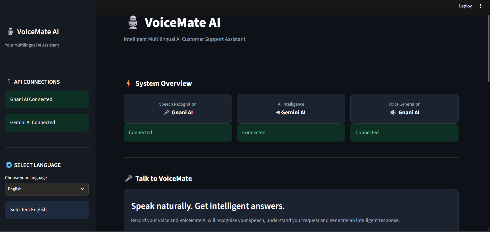

# 🎙️ VoiceMate AI

### Multilingual AI-Powered Customer Support Assistant

VoiceMate AI is an intelligent voice-based customer support assistant that allows users to communicate naturally and receive AI-generated responses. It combines speech recognition, generative AI and text-to-speech technology to create an interactive multilingual experience.

## 🚀 Project Overview

VoiceMate AI converts spoken questions into text, processes them using Google Gemini and generates intelligent responses. Users can also listen to AI-generated voice responses.

The application includes a modern dark-themed Streamlit dashboard.

## ✨ Key Features

- 🎤 **Speech-to-Text:** Converts spoken audio into text using Gnani AI.
- 🤖 **AI Responses:** Generates intelligent answers using Google Gemini.
- 🔊 **Text-to-Speech:** Converts AI-generated text into speech using Gnani AI.
- 🌐 **Multilingual Support:** Language options for English, Kannada, Hindi, Tamil and Telugu.
- 💬 **Text Interaction:** Allows users to ask questions without recording audio.
- 🎨 **Modern Dashboard:** Professional dark-themed Streamlit interface.
- 🔌 **API Status:** Displays API connection information.

*Note: Language options are available; individual language accuracy and voice support should be validated.*

## 🛠️ Technologies Used

| Technology | Purpose |
|---|---|
| Python | Core programming language |
| Streamlit | Web application interface |
| Gnani AI | Speech-to-Text and Text-to-Speech |
| Google Gemini | AI response generation |
| Pandas | Data handling |
| Python Dotenv | Environment variable management |
| Git & GitHub | Version control |

## 📁 Project Structure

```text
VoiceMate_AI/
│
├── app.py
├── ai_assistant.py
├── speech_to_text.py
├── text_to_speech.py
├── requirements.txt
├── README.md
├── .gitignore
└── .env
```

## ⚙️ Installation and Setup

### 1. Clone the Repository

```bash
git clone https://github.com/harshithkumark01-byte/VoiceMate_AI.git
```

### 2. Navigate to the Project Folder

```bash
cd VoiceMate_AI
```

### 3. Create a Virtual Environment

```bash
python -m venv venv
```

### 4. Activate Virtual Environment

For Windows PowerShell:

```powershell
.\venv\Scripts\Activate.ps1
```

### 5. Install Dependencies

```bash
pip install -r requirements.txt
```

### 6. Configure API Keys

Create a `.env` file in the project root directory.

Add your API keys:

```env
GNANI_API_KEY=your_gnani_api_key
GEMINI_API_KEY=your_gemini_api_key
```

Replace the placeholder values with your actual API keys.

**Important:** Never upload your `.env` file or expose your API keys publicly.

### 7. Run the Application

```bash
streamlit run app.py
```

The application will open in your browser.

## 🖥️ Application Workflow

1. Select your preferred language.
2. Record your voice using the microphone.
3. Click **Process My Voice**.
4. Gnani AI converts speech into text.
5. Google Gemini processes the recognized text.
6. VoiceMate AI displays the generated response.
7. Click **Listen to AI Response** to hear the answer.

Users can also interact through text input and use the standalone Text-to-Speech feature.

## 📸 Application Screenshots

### VoiceMate AI Dashboard


## 🔮 Future Enhancements

- Improved multilingual conversation accuracy.
- Conversation history and session management.
- User authentication.
- Customer support analytics dashboard.
- Cloud deployment.
- Integration with customer support platforms.

## 👨‍💻 Author

**Harshith Kumar K.**

Aspiring Data Scientist | Python | SQL | AI & Machine Learning

GitHub: [harshithkumark01-byte](https://github.com/harshithkumark01-byte)

## 📄 License

This project is developed for educational and internship purposes.